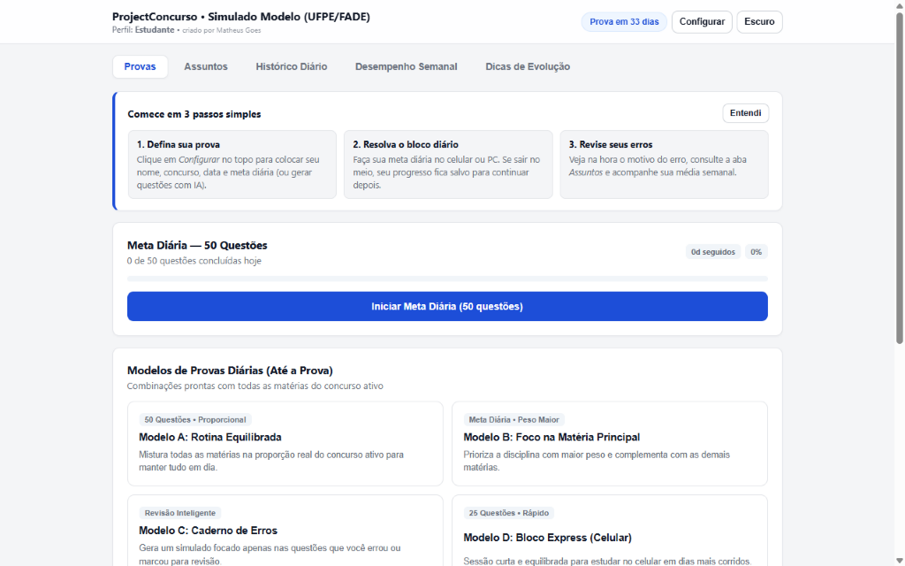
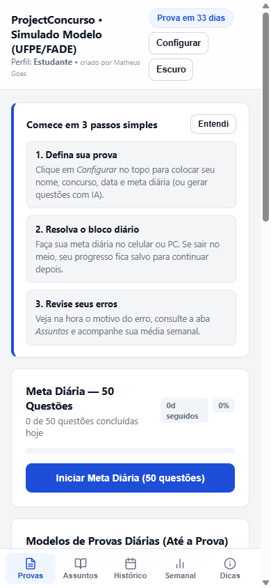

# ProjectConcurso

Plataforma gratuita, responsiva (PWA) e **beginner-friendly** para qualquer pessoa estudar diariamente para **qualquer concurso público, certificação ou prova**, no **computador** ou em **qualquer celular (Android ou iOS)** — inclusive offline após o primeiro acesso.

> Criado por **Matheus Goes** — sem necessidade de login ou servidor complexo.

---

## Visual do Projeto

### Computador (Desktop)


### Celular (Mobile PWA)
<p align="center">
  
</p>

---

## Principais Funcionalidades

1. **Perfis Exclusivos e Isolados (`Configurar → Usuários`):**
   - Cada pessoa pode criar seu **próprio usuário** no mesmo dispositivo, mantendo histórico diário, meta, concurso ativo e sessões salvas totalmente separados.

2. **Troca Completa de Concurso com Agente de IA (`Configurar → Trocar Concurso (IA)`):**
   - Informe **qual prova quer fazer**, **quais matérias precisa estudar** e **quanto tempo tem até a prova**.
   - Copie o prompt pronto gerado pelo app, cole no ChatGPT, Gemini ou Claude e importe o arquivo `.json` gerado para transformar o **ProjectConcurso** por completo no seu edital.

3. **Provas, Modelos Diários e Retomada Automática:**
   - **Meta Diária configurável** (padrão inicial: 50 questões/dia) com ofensiva de dias seguidos e salvamento automático a cada resposta.
   - **Modelos A/B/C/D:** *Rotina Equilibrada*, *Foco na Matéria Principal*, *Caderno de Erros* (revisa automaticamente o que você errou) e *Bloco Express (25q)*.
   - **Prova Completa e Treinos por Matéria** gerados dinamicamente a partir do pacote ativo.

4. **Correção Imediata + Explicação do Erro:**
   - Ao errar uma questão, exibe **Por que você errou**, **Gabarito comentado** e atalho direto para **Entender este assunto**.
   - Cronômetro aberto registrando tempo total da sessão e tempo individual por questão.

5. **Guia de Assuntos, Histórico Diário, Desempenho Semanal e Dicas:**
   - Aba **Assuntos** com busca por palavra-chave e filtro por disciplina.
   - **Histórico Diário** com detalhamento por questão/tempo e **Exportar / Importar Backup (`.json`)**.
   - **Desempenho Semanal (%)** com gráfico Seg–Dom e **Dicas de Evolução** automáticas.
   - **Modo Claro / Escuro** e suporte offline via **Service Worker (`sw.js`)**.

---

## Como Usar em Qualquer Lugar (GitHub Pages + Celular)

1. Acesse o link do **GitHub Pages** do repositório:
   - `https://matheusbgoes.github.io/ProjectConcurso/`
2. No **celular (Android ou iOS)**, abra o link no navegador e toque em **"Adicionar à tela inicial"** para instalar como aplicativo.
3. Clique em **Configurar** no topo para definir seu usuário, o nome da sua prova, a data da prova e sua meta diária.

---

## Estrutura dos Arquivos

- `index.html` — Aplicação completa (interface responsiva, motor dinâmico, banco modelo de 80 questões e guia de assuntos).
- `manifest.json` e `sw.js` — Configuração PWA e cache offline para uso em qualquer celular ou PC.
- `docs/` — Imagens reais da aplicação (`desktop.png` e `mobile.png`).
- `README.md` — Documentação do projeto e formato do pacote `.json`.

---

## Formato do Pacote de Concurso (`.json`)

```json
{
  "examName": "Nome do Concurso ou Prova",
  "questions": [
    {
      "subject": "Nome da Matéria",
      "q": "Enunciado da questão...",
      "options": [
        "A) Alternativa A",
        "B) Alternativa B",
        "C) Alternativa C",
        "D) Alternativa D",
        "E) Alternativa E"
      ],
      "answer": 0,
      "summary": "Explicação clara do gabarito.",
      "wrongNotes": {
        "1": "Opcional: por que a alternativa B está errada."
      }
    }
  ],
  "topics": [
    {
      "subject": "Nome da Matéria",
      "title": "Título do Assunto",
      "body": "Explicação didática do conteúdo.",
      "tip": "Dica rápida de prova."
    }
  ]
}
```
